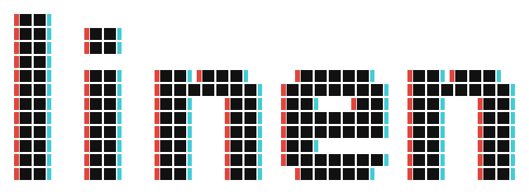
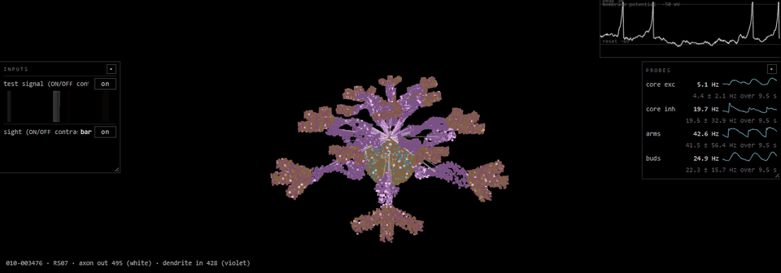
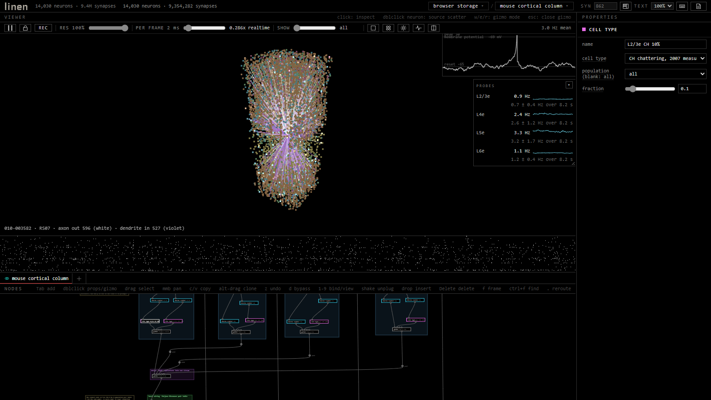
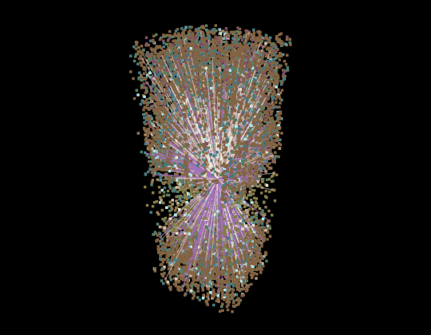

<p align="center">
  <picture>
    <source media="(prefers-color-scheme: dark)" srcset="brand/linen-dark.svg">
    
  </picture>
</p>

<p align="center">A sandbox for 3D spiking neural networks.</p>

<p align="center"><b><a href="https://linen.build">Try it in your browser</a></b> · <a href="#quick-start">Run it locally</a> · <a href="https://linen.build/docs">Docs</a></p>

<p align="center"></p>

Welcome! I hope you enjoy using linen. Build large networks of neurons with intuitive node trees to observe and measure their firing patterns.

linen is an ongoing project and was initially built as an educational tool for computational neuroscience. It features established formulas (outlined in references) to model neurons and synapses, and to alter weights with spike-timing-dependent plasticity (STDP) and other learning rules. Feed audio, images, video, or electrical stimuli into the tissue and measure how competition and inhibition can change synapse weights and firing patterns over time.

You can start with preset scenarios, many based on real scientific papers and their measurements, or from scratch to build tissues based on your findings (or your imagination). You can even build your own nodes and engines if you want to experiment with different models.

As of now, linen is not a scientific instrument and is not meant to replace any of the other amazing tools that exist out there, however it does have the ability to import and export file types familiar to computational neuroscientists.

There are a lot of features to dive into, so I hope you can enjoy using it as much as I enjoy working on it. This is a long-term project as I study, so I would love to get your feedback, keep improving it, and learn in the process!

Have fun,

Seth

## Getting started

The easiest way to try linen is at [linen.build](https://linen.build), where everything runs right in your browser. If you'd like to run it on your own machine, clone the repository and start the small server that comes with it. There's nothing else to install.

```
git clone https://github.com/sethgjosephson/linen
cd linen
python3 serve.py 8173      # on Windows: py serve.py 8173
```

Then open http://localhost:8173. Running it locally also gives linen a project folder, so your scenes and trained networks are saved as files on your disk.

There's also a desktop app, which is the same linen in a window of its own, with the server and the engine host inside it, so nothing runs in a browser tab and a long training run keeps its full speed in the background. For now it runs from source and needs [Node](https://nodejs.org):

```
cd linen/desktop
npm install
npm start
```

The first launch asks where your project folder should live. It has been run on Windows so far; macOS and Linux should work but haven't been tried, and an installer will come later.

## A quick tour

<p align="center"></p>

Every network is built in the node graph at the bottom of the screen. You start with a shape, fill it with neurons, wire them together and add something to stimulate them, and the result appears in the 3D viewer above as soon as it's ready. Press Tab to add a node, and double-click one to change its settings.

Once the network is running, try clicking a neuron. Its connections light up, and you can watch its membrane potential rise and fall as it fires. Probes keep track of firing rates across whole populations, and chart nodes turn what they measure into figures you can save.

<p align="center"></p>

You don't have to start from a blank graph. The Tab menu has scenes ready to explore, from a sheet of cortex where waves of activity roll across and collide, to a mouse cortical column built from published measurements, to small classics like gamma rhythms and working memory. Every node is a good one to open if you want to see a little of everything at once.

## Under the hood

Each neuron follows the Izhikevich model, a simple set of equations that can reproduce the firing patterns of many real cell types. Neurons connect to their neighbors by distance, and signals take a little longer to arrive the farther they travel. As the network runs, its synapses can strengthen or weaken through spike-timing-dependent plasticity and a handful of related learning rules. [MODEL.md](MODEL.md) goes through every equation and the paper it comes from.

The same network can run on three engines: one in your browser, a faster one on your graphics card through WebGPU, and a CUDA engine for very large networks and long training runs. They're tested against each other, so a network behaves alike wherever it runs.

## Making it your own

When you outgrow the built-in nodes, you can write your own. A node is a single JavaScript file in your project's nodes folder, and [EXTENDING.md](EXTENDING.md) shows how, with a small example to copy. You can even connect your own simulation engine, in any language, and [ENGINE.md](ENGINE.md) describes what it needs to do.

Your results can leave linen too. Charts save as images or spreadsheets, networks export as tables or as a Brian 2 script, and `tools/linen.mjs` runs any scene from the command line and writes spike trains that Python tools like pandas and Neo can read.

## Where it's headed

The long-term goal is a full cubic millimeter of mouse cortex, around a hundred thousand neurons and a billion synapses, running on a GPU. Along the way, tools for stimulating and lesioning regions and for recording local field potentials are next on the list. Ideas and feedback are always welcome.

## Citing and license

If linen helps your work, `CITATION.cff` has the citation details (GitHub shows it as a "Cite this repository" button), and `CHANGELOG.md` lists what changed in each release.

linen is licensed under AGPL-3.0-or-later; see [LICENSE](LICENSE) and [COPYRIGHT.md](COPYRIGHT.md). Contributions are welcome and need the [CLA](CLA.md).

## Sources & inspirations

Simulation methods:

- Izhikevich, E. M. (2003), *Simple model of spiking neurons*, IEEE Trans. Neural Networks. https://www.izhikevich.org/publications/spikes.htm (classic presets)
- Izhikevich, E. M. (2007), *Dynamical Systems in Neuroscience: The Geometry of Excitability and Bursting*, MIT Press, chapter 8 (membrane, measured rows)
- NEST spatially structured networks: https://nest-simulator.readthedocs.io/en/stable/tutorials/pynest_tutorial/part_4_spatially_structured_networks.html (kernels, masks)
- Brunel, N. (2000), balanced E/I network dynamics (the regimes)
- van Albada, Helias & Diesmann (2015), *Scalability of Asynchronous Networks Is Limited by One-to-One Mapping between Effective Connectivity and Correlations*, PLOS Comput. Biol.: https://journals.plos.org/ploscompbiol/article?id=10.1371/journal.pcbi.1004490 (downscaling)
- Song, Miller & Abbott (2000), Bi & Poo (1998), Vogels et al. (2011), Pfister & Gerstner (2006), Zenke, Agnes & Gerstner (2015), Tsodyks & Markram (1997), van Rossum, Bi & Turrigiano (2000) (plasticity rules)
- Pokorny, Ison, Rao, Legenstein, Papadimitriou & Maass (2019), *STDP Forms Associations between Memory Traces in Networks of Spiking Neurons*, Cerebral Cortex 29(8): 3577-3589. https://pmc.ncbi.nlm.nih.gov/articles/PMC7132978/ (the weave)

Columns and dendrites (background; `references/INDEX.md`):

- Harris, K. D. & Shepherd, G. M. G. (2015), *The neocortical circuit: themes and variations*, Nature Neuroscience 18(2): 170-181. https://pmc.ncbi.nlm.nih.gov/articles/PMC4889215/
- Hawkins & Ahmad (2016), *Why Neurons Have Thousands of Synapses, a Theory of Sequence Memory in Neocortex*, Front. Neural Circuits 10:23. https://www.frontiersin.org/journals/neural-circuits/articles/10.3389/fncir.2016.00023/full
- Hawkins, Ahmad & Cui (2017), *A Theory of How Columns in the Neocortex Enable Learning the Structure of the World*, Front. Neural Circuits 11:81. https://pmc.ncbi.nlm.nih.gov/articles/PMC5661005/
- Hawkins, Lewis, Klukas, Purdy & Ahmad (2019), *A Framework for Intelligence and Cortical Function Based on Grid Cells in the Neocortex*, Front. Neural Circuits 12:121. https://www.frontiersin.org/journals/neural-circuits/articles/10.3389/fncir.2018.00121/full
- Hawkins, Leadholm & Clay (2025), *Hierarchy or Heterarchy? A Theory of Long-Range Connections for the Sensorimotor Brain*, arXiv:2507.05888; Clay, Leadholm & Hawkins (2024), *The Thousand Brains Project*, arXiv:2412.18354; Leadholm, Clay, Knudstrup, Lee & Hawkins (2025), *Thousand-Brains Systems*, arXiv:2507.04494; Hawkins (2021), *A Thousand Brains*, Basic Books
- Haueis, P. (2016), *The life of the cortical column: opening the domain of functional architecture of the cortex (1955-1981)*, History and Philosophy of the Life Sciences 38:2. https://pmc.ncbi.nlm.nih.gov/articles/PMC4914527/ (the column concept)
- Wright, Hedrick & Komiyama (2025), *Distinct synaptic plasticity rules operate across dendritic compartments in vivo during learning*, Science 388(6744): 322-328. https://www.science.org/doi/10.1126/science.ads4706 (dendritic plasticity rules)

Tools:

- NEST Desktop, Spreizer et al. 2021, eNeuro. https://www.eneuro.org/content/8/6/ENEURO.0274-21.2021 (education-first GUI)
- NetPyNE, Dura-Bernal et al. 2019, eLife. https://elifesciences.org/articles/44494 (declarative specs, LFP)
- BrainX3, Arsiwalla et al. 2015, Front. Neuroinform. https://pmc.ncbi.nlm.nih.gov/articles/PMC4338755/ (lesioning, sim/render decoupling)
- The Virtual Brain on EBRAINS, Schirner et al. 2022, NeuroImage. https://www.sciencedirect.com/science/article/pii/S1053811922001021 (stimulation protocols)
- Neuronify, Dragly et al. 2017, eNeuro. https://www.eneuro.org/content/4/2/ENEURO.0022-17.2017 (sandbox UX)
- Brian 2, Stimberg, Brette & Goodman 2019, eLife. https://pmc.ncbi.nlm.nih.gov/articles/PMC6786860/ (equations, code generation)

Performance:

- Fidjeland & Shanahan (2010), GPU-accelerated Izhikevich networks: https://www.doc.ic.ac.uk/~mpsha/IJCNN10b.pdf
- Golosio et al. (2021), NeuronGPU, 1M-neuron GPU simulations: https://www.frontiersin.org/journals/computational-neuroscience/articles/10.3389/fncom.2021.627620/full
- Sun, Su, ... Akarca (2026), *Algorithm-hardware co-design of neuromorphic networks with dual memory pathways*, Nature Machine Intelligence 8:901-912. https://www.nature.com/articles/s42256-026-01255-3 (a shared slow state in place of dense recurrence and per-connection delays)

Biology:

- Gebicke-Haerter, P. J. (2023), *The computational power of the human brain*, Frontiers in Cellular Neuroscience 17:1220030. https://pmc.ncbi.nlm.nih.gov/articles/PMC10441807/ (what point neurons leave out)
