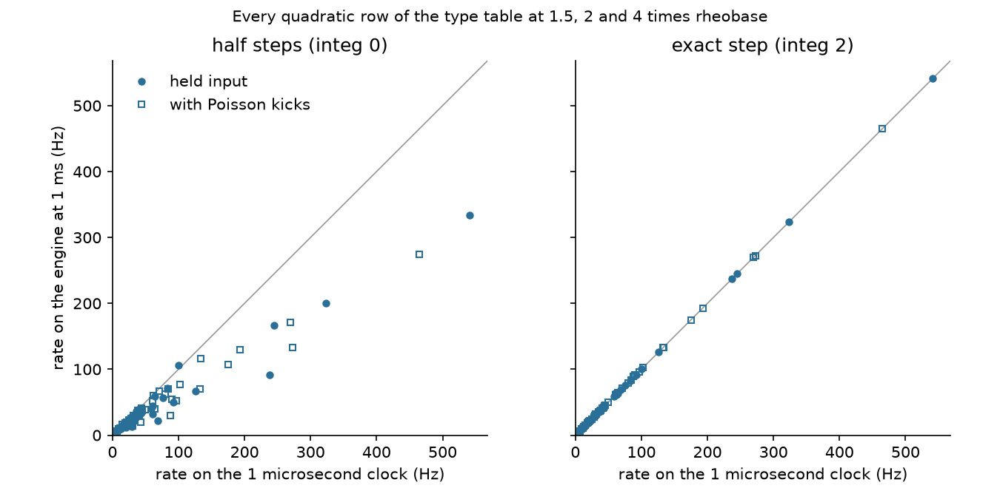

# The membrane step, measured on 0.3.0

The checkpoint's membrane step (`integ`, MODEL.md 1) has three settings in 0.3.0: the half steps of Izhikevich's 2003 program (0, the default), the exponential step (1), and the exact step on the equations (2). This record measures what the exact step changes, on the 0.3.0 tree as released, with the tools that ship in it. Every command below runs from the repository root; the Python ones need Brian 2 or NumPy in `.venv-analysis` (EXTENDING.md).

Run on 2026-11-05 on one machine with an sm_89 NVIDIA GPU. Rates are from single runs on one seed unless a tool says otherwise.

## 1. One cell against the equations

`node tools/izhsteps.mjs` runs every quadratic row of the type table as one cell: on the reference engine under the half steps and under the exact step, and on a 1 microsecond Euler clock that stands for the equations. The input is the row's rheobase times 1.5, 2 and 4, held, and the same with Poisson kicks. The rate is counted over the second half of 4 s.

| step | mean rate error | worst |
|---|---|---|
| half steps (integ 0) | 21.6% | 68.8% |
| exact step (integ 2) | 0.6% | 5.9% |



The full table, as printed:

| row | input | drive | 1 us clock Hz | half steps Hz | equations' step Hz |
|---|---|---|---|---|---|
| RS | held | 1.5x | 12.5 | 11.5 | 12.5 |
| RS | held | 2x | 16.5 | 15.0 | 17.0 |
| RS | held | 4x | 33.0 | 29.0 | 33.5 |
| RS | kicks | 1.5x | 22.0 | 20.0 | 22.0 |
| RS | kicks | 2x | 29.5 | 25.5 | 29.5 |
| RS | kicks | 4x | 61.0 | 52.5 | 61.5 |
| IB | held | 1.5x | 16.0 | 13.5 | 16.0 |
| IB | held | 2x | 23.5 | 19.5 | 23.5 |
| IB | held | 4x | 61.0 | 44.0 | 61.0 |
| IB | kicks | 1.5x | 35.5 | 27.5 | 35.5 |
| IB | kicks | 2x | 49.5 | 39.0 | 49.5 |
| IB | kicks | 4x | 102.0 | 76.5 | 102.5 |
| CH | held | 1.5x | 44.0 | 34.5 | 44.5 |
| CH | held | 2x | 60.5 | 32.0 | 61.0 |
| CH | held | 4x | 126.0 | 66.5 | 126.0 |
| CH | kicks | 1.5x | 64.0 | 39.5 | 65.0 |
| CH | kicks | 2x | 90.5 | 54.5 | 91.0 |
| CH | kicks | 4x | 175.5 | 107.0 | 174.5 |
| FS | held | 1.5x | 58.5 | 39.5 | 59.0 |
| FS | held | 2x | 92.5 | 49.5 | 92.0 |
| FS | held | 4x | 237.5 | 91.0 | 237.0 |
| FS | kicks | 1.5x | 96.5 | 52.0 | 96.5 |
| FS | kicks | 2x | 133.0 | 70.5 | 133.0 |
| FS | kicks | 4x | 272.5 | 133.0 | 272.5 |
| LTS | held | 1.5x | 12.0 | 10.0 | 12.0 |
| LTS | held | 2x | 14.5 | 12.0 | 14.5 |
| LTS | held | 4x | 24.0 | 18.0 | 23.5 |
| LTS | kicks | 1.5x | 15.0 | 12.5 | 15.0 |
| LTS | kicks | 2x | 18.5 | 14.5 | 18.5 |
| LTS | kicks | 4x | 32.0 | 21.5 | 32.0 |
| TC | held | 1.5x | 20.0 | 11.5 | 20.5 |
| TC | held | 2x | 29.0 | 13.5 | 29.0 |
| TC | held | 4x | 69.0 | 21.5 | 69.0 |
| TC | kicks | 1.5x | 30.5 | 14.5 | 31.5 |
| TC | kicks | 2x | 42.5 | 19.5 | 42.5 |
| TC | kicks | 4x | 88.0 | 30.0 | 89.5 |
| RZ | held | 1.5x | 28.0 | 22.0 | 28.5 |
| RZ | held | 2x | 30.5 | 24.5 | 31.5 |
| RZ | held | 4x | 39.0 | 29.5 | 39.5 |
| RZ | kicks | 1.5x | 28.0 | 22.0 | 28.0 |
| RZ | kicks | 2x | 31.0 | 24.5 | 32.0 |
| RZ | kicks | 4x | 40.5 | 30.0 | 40.5 |
| FL | held | 1.5x | 6.5 | 6.5 | 6.5 |
| FL | held | 2x | 10.5 | 10.5 | 10.5 |
| FL | held | 4x | 24.0 | 23.5 | 24.0 |
| FL | kicks | 1.5x | 6.5 | 6.5 | 6.5 |
| FL | kicks | 2x | 11.5 | 11.0 | 11.0 |
| FL | kicks | 4x | 24.5 | 23.0 | 24.5 |
| RS07 | held | 1.5x | 8.5 | 8.5 | 8.0 |
| RS07 | held | 2x | 13.5 | 14.5 | 14.0 |
| RS07 | held | 4x | 36.5 | 37.0 | 36.5 |
| RS07 | kicks | 1.5x | 9.5 | 10.0 | 9.5 |
| RS07 | kicks | 2x | 14.5 | 16.0 | 15.0 |
| RS07 | kicks | 4x | 38.0 | 37.5 | 37.5 |
| IB07 | held | 1.5x | 11.5 | 11.0 | 11.5 |
| IB07 | held | 2x | 22.0 | 20.5 | 22.0 |
| IB07 | held | 4x | 64.0 | 59.0 | 64.0 |
| IB07 | kicks | 1.5x | 19.5 | 19.0 | 19.5 |
| IB07 | kicks | 2x | 32.0 | 30.0 | 32.0 |
| IB07 | kicks | 4x | 71.0 | 66.5 | 71.5 |
| CH07 | held | 1.5x | 28.0 | 27.0 | 28.0 |
| CH07 | held | 2x | 41.0 | 40.0 | 41.0 |
| CH07 | held | 4x | 100.0 | 106.0 | 100.0 |
| CH07 | kicks | 1.5x | 43.5 | 41.5 | 44.0 |
| CH07 | kicks | 2x | 62.0 | 60.0 | 62.5 |
| CH07 | kicks | 4x | 133.5 | 116.0 | 133.5 |
| FS07 | held | 1.5x | 245.0 | 166.5 | 245.0 |
| FS07 | held | 2x | 323.5 | 200.0 | 323.5 |
| FS07 | held | 4x | 540.5 | 333.5 | 541.0 |
| FS07 | kicks | 1.5x | 193.0 | 130.0 | 193.0 |
| FS07 | kicks | 2x | 269.0 | 171.5 | 270.0 |
| FS07 | kicks | 4x | 465.0 | 274.5 | 465.0 |
| LTS07 | held | 1.5x | 19.0 | 16.5 | 19.0 |
| LTS07 | held | 2x | 30.5 | 24.0 | 30.0 |
| LTS07 | held | 4x | 76.0 | 56.5 | 76.0 |
| LTS07 | kicks | 1.5x | 24.5 | 20.5 | 24.5 |
| LTS07 | kicks | 2x | 37.0 | 29.0 | 37.0 |
| LTS07 | kicks | 4x | 79.5 | 62.5 | 79.5 |
| TC07 | held | 1.5x | 10.5 | 8.5 | 10.5 |
| TC07 | held | 2x | 16.5 | 13.5 | 16.5 |
| TC07 | held | 4x | 41.5 | 32.5 | 41.5 |
| TC07 | kicks | 1.5x | 12.5 | 11.0 | 12.5 |
| TC07 | kicks | 2x | 20.5 | 15.5 | 20.5 |
| TC07 | kicks | 4x | 45.5 | 37.5 | 45.5 |
| RZ07 | held | 1.5x | 25.5 | 23.0 | 25.5 |
| RZ07 | held | 2x | 38.0 | 33.0 | 38.0 |
| RZ07 | held | 4x | 83.0 | 71.5 | 83.0 |
| RZ07 | kicks | 1.5x | 28.0 | 25.0 | 28.0 |
| RZ07 | kicks | 2x | 41.5 | 36.0 | 41.5 |
| RZ07 | kicks | 4x | 84.0 | 70.5 | 83.5 |

## 2. Izhikevich 2003, Fig. 2

`node tools/published.mjs` reproduces the cell classes of Izhikevich 2003 Fig. 2 on the engine at 1 ms and on the published equations at 0.1 ms. In 0.3.0 the engine runs the classes under both steps and every criterion the equations pass is gated on both. The section of the output:

```
published: Izhikevich 2003, Fig. 2, the cell classes (the engine at 1 ms under the half steps and under the exact step, the published equations at 0.1 ms)
  RS   0.1 ms       23 Hz, intervals 18.1 45.3 45.2 45.2 45.2 45.2 ...
       half steps  21 Hz, intervals 39 49 48 58 48 49 ...
       exact step  23 Hz, intervals 17 45 44 45 45 45 ...
  IB   0.1 ms       34 Hz, intervals 2.4 3.8 38.2 31.6 31.6 31.6 ...
       half steps  27 Hz, intervals 5 43 50 42 37 34 ...   rate differs by 21 percent
       exact step  34 Hz, intervals 2 3 38 31 31 31 ...
  CH   0.1 ms       86 Hz, intervals 1.6 1.7 1.9 2.1 2.5 3.1 ...
       half steps  48 Hz, intervals 3 3 4 48 4 48 ...   rate differs by 44 percent
       exact step  88 Hz, intervals 1 2 1 2 2 3 ...
  FS   0.1 ms       126 Hz, intervals 4.3 6.1 7.6 8.0 7.9 8 ...
       half steps  68 Hz, intervals 18 12 11 13 12 11 ...   rate differs by 46 percent
       exact step  136 Hz, intervals 4 5 7 7 8 7 ...
  LTS  0.1 ms       75 Hz, intervals 3.1 3.8 4.9 7.1 11.2 13.8 ...
       half steps  48 Hz, intervals 7 19 20 16 17 16 ...   rate differs by 36 percent
       exact step  78 Hz, intervals 3 3 5 6 10 13 ...
  recorded, not gated: FS: "practically without any adaptation" (last interval within 20 percent of the first). The published equations at 0.1 ms do not show it (first 4.3, last 8.1 ms); the engine under the half steps: first 18, last 15 ms; under the exact step: first 4, last 7 ms
  recorded, not gated: TC: "a rebound burst of action potentials" after release from -87 mV (two or more spikes within 100 ms, every interval under 10 ms). The published equations at 0.1 ms do not show it (7 spikes, intervals 4.3 4.9 5.7 7 9.7 24.8); the engine under the half steps: 3 spikes, intervals 6 20; under the exact step: 8 spikes, intervals 4 4 5 6 7 10 22
```

The whole run: `published: all passed (60)` (50 checks in 0.2.0; the ten new ones are the cell-class criteria under the exact step).

## 3. The engines agree

The one-cell cases of the exact step on the reference engine, and the same cases on the CUDA engine read back tick by tick:

```
=== node src/integ.test.mjs
integ: all passed (14)

=== node cuda/integtest.mjs
integtest: all passed (10)
```

The WebGPU engine's rates appear beside the other two engines' in the cost table below; a step that differed between engines would show there as a different rate.

## 4. What it changes on the tissue scenes

Four Tab-menu scenes run on the exact step in 0.3.0. `node tools/tune.mjs <scene> 3 1` runs a scene for 3 s on the reference engine at full density and prints the rate of each population. Each scene was run under the half steps with the 0.2.0 drives, under the exact step with the 0.2.0 drives, and as shipped (the exact step with the 0.3.0 drives). The band is the one the statistics battery holds the scene to (`src/validate.js`, "the tissue scenes fire in their bands"); the column's layers also carry the de Kock and Sakmann 2009 bands the drives were tuned to.

The mouse cortical column (14,031 cells, 9.35 M synapses). Drives unchanged in 0.3.0.

| population | battery band (Hz) | de Kock and Sakmann 2009 (Hz) | half steps | exact step |
|---|---|---|---|---|
| L2/3e | 0.5 to 25 | 0.2 to 1 | 0.65 | 0.63 |
| L4e | 0.5 to 25 | 0.5 to 3 | 2.33 | 2.28 |
| L5e | 0.5 to 30 | 2 to 4 | 2.92 | 2.89 |
| L6e | 0.5 to 25 | 0.3 to 2 | 1.15 | 1.18 |
| L2/3i | 1 to 40 | | 5.61 | 5.77 |
| L4i | 1 to 40 | | 8.78 | 9.14 |
| L5i | | | 20.17 | 21.40 |
| L6i | | | 18.73 | 19.23 |
| L2/3s | 1 to 40 | | 2.21 | 2.24 |
| L4s | 1 to 40 | | 5.96 | 5.86 |
| L5s | | | 3.00 | 3.05 |
| L6s | | | 1.34 | 1.46 |

The visual pathway (17,845 cells, 10.6 M synapses), driven by its bar sweep. Drives unchanged in 0.3.0.

| population | battery band (Hz) | half steps | exact step |
|---|---|---|---|
| rgc | 3 to 60 | 7.91 | 7.80 |
| lgn | 3 to 40 | 7.31 | 7.52 |
| trn | | 3.01 | 4.19 |
| L4e | 2 to 30 | 7.96 | 7.90 |
| L2/3e | 1 to 30 | 2.73 | 2.64 |
| L2/3i | | 6.75 | 7.04 |
| L4i | | 12.63 | 13.26 |
| L5e | | 4.55 | 4.52 |
| L5i | | 16.53 | 17.55 |
| L6e | | 1.67 | 1.70 |
| L6i | | 14.01 | 14.42 |

The thalamocortical loop (31,554 cells, 15.7 M synapses). In 0.3.0 the relay hold is -800 pA (was -500) and the cortical excitatory drive 86 pA (was 80).

| population | battery band (Hz) | half steps, 0.2.0 drives | exact step, 0.2.0 drives | exact step, 0.3.0 drives |
|---|---|---|---|---|
| ce | 1 to 25 | 6.31 | 5.25 | 6.10 |
| ci | 2 to 40 | 10.95 | 10.11 | 11.49 |
| tract | | 11.25 | 16.60 | 14.75 |
| tc | 5 to 40 | 17.23 | 19.69 | 17.30 |
| rz | 2 to 40 | 8.43 | 9.17 | 8.40 |

CA3 pattern completion (7,519 cells, 1.84 M synapses). In 0.3.0 the background noise is 210 pA (was 240).

| population | battery band (Hz) | half steps, 0.2.0 drive | exact step, 0.2.0 drive | exact step, 0.3.0 drive |
|---|---|---|---|---|
| ca3 | 0.1 to 3 | 1.33 | 1.39 | 1.31 |
| ca3i | 0.5 to 10 | 6.68 | 7.42 | 6.62 |

Every population stays inside its battery band under every step. The retuning put the loop's relay and cortex and CA3's two populations back where the half steps had them.

The commands, with the 0.2.0 drives given as overrides on the nodes that hold them:

```
node tools/tune.mjs "mouse cortical column" 3 1
OVER="checkpoint:*:integ=0" node tools/tune.mjs "mouse cortical column" 3 1
INPUT=1 node tools/tune.mjs "visual pathway" 3 1
OVER="checkpoint:*:integ=0" INPUT=1 node tools/tune.mjs "visual pathway" 3 1
node tools/tune.mjs "thalamocortical loop" 3 1
OVER="stimulus:ce:current=80;stimulus:tc:current=-500" node tools/tune.mjs "thalamocortical loop" 3 1
OVER="checkpoint:*:integ=0;stimulus:ce:current=80;stimulus:tc:current=-500" node tools/tune.mjs "thalamocortical loop" 3 1
node tools/tune.mjs "CA3 pattern completion" 3 1
OVER="stimulus:background noise:current=240" node tools/tune.mjs "CA3 pattern completion" 3 1
OVER="checkpoint:*:integ=0;stimulus:background noise:current=240" node tools/tune.mjs "CA3 pattern completion" 3 1
```

## 5. Cost

`node tools/enginebench.mjs <scene> --over "checkpoint:*:integ=N" --engines cpu,cuda,webgpu --serve URL --project DIR` computes a scene once and times the same network on the reference engine (1 simulated second after a 1 s warm-up), the CUDA engine and the WebGPU engine (5 s each). Speed is simulated time over wall time; each engine's mean rate is printed beside it.

The balanced random net (24,127 cells, 14.4 M synapses), as shipped. Speed as a multiple of real time, and deliveries per second:

| engine | half steps (0) | exponential (1) | exact (2) | mean rate under each (Hz) |
|---|---|---|---|---|
| cpu | 1.75x, 111 M/s | 1.74x, 111 M/s | 0.29x, 20 M/s | 4.87, 4.87, 5.20 |
| cuda | 30.62x, 1955 M/s | 33.31x, 2126 M/s | 25.07x, 1713 M/s | 4.89, 4.89, 5.22 |
| webgpu | 2.94x, 187 M/s | 2.93x, 187 M/s | 2.84x, 194 M/s | 4.89, 4.89, 5.23 |

The mouse cortical column (14,031 cells, 9.35 M synapses) with its two pulse trains turned to steady zero (`stimulus:E:mode=0;stimulus:E:current=0;stimulus:I:mode=0;stimulus:I:current=0`), since the CUDA engine does not take a pulse-train stimulus from this bench; the column then runs at its spontaneous rate:

| engine | half steps (0) | exponential (1) | exact (2) | mean rate under each (Hz) |
|---|---|---|---|---|
| cpu | 2.13x, 18 M/s | 2.04x, 17 M/s | 0.49x, 4 M/s | 0.72, 0.72, 0.71 |
| cuda | 17.10x, 143 M/s | 18.22x, 152 M/s | 18.87x, 156 M/s | 0.72, 0.72, 0.71 |
| webgpu | 3.51x, 29 M/s | 3.53x, 29 M/s | 3.51x, 29 M/s | 0.72, 0.72, 0.71 |

The column as shipped, pulses on, on the two engines that take them:

| engine | half steps (0) | exponential (1) | exact (2) | mean rate under each (Hz) |
|---|---|---|---|---|
| cpu | 1.53x, 45 M/s | 1.50x, 44 M/s | 0.44x, 13 M/s | 2.91, 2.91, 2.89 |
| webgpu | 2.57x, 75 M/s | 2.58x, 76 M/s | 2.57x, 76 M/s | 2.90, 2.90, 2.92 |

The exact step costs the reference engine 4 to 6 times its speed; the exponential step costs it nothing. On the GPU engines, where delivery dominates, the exact step costs the CUDA engine 18 percent on the balanced net and nothing on the column, and the WebGPU engine 3 percent on the balanced net and nothing on the column. The three engines report the same mean rate under each step.

The outputs:

```
=== mouse cortical column | checkpoint:*:integ=0
mouse cortical column: 14,031 cells, 9,352,810 synapses (mean in-degree 667), plasticity off, computed in 6.3 s
webgpu      2.57x realtime       75 M deliveries/s    2.90 Hz mean  (5 s simulated in 1.95 s; init and warm-up 1.3 s)
cuda    failed: the cuda engine does not implement pulse train stimulus
cpu         1.53x realtime       45 M deliveries/s    2.91 Hz mean  (1 s simulated in 0.65 s; init and warm-up 0.7 s)

=== mouse cortical column | checkpoint:*:integ=1
mouse cortical column: 14,031 cells, 9,352,810 synapses (mean in-degree 667), plasticity off, computed in 6.3 s
webgpu      2.58x realtime       76 M deliveries/s    2.90 Hz mean  (5 s simulated in 1.94 s; init and warm-up 1.3 s)
cuda    failed: the cuda engine does not implement pulse train stimulus
cpu         1.50x realtime       44 M deliveries/s    2.91 Hz mean  (1 s simulated in 0.67 s; init and warm-up 0.7 s)

=== mouse cortical column | checkpoint:*:integ=2
mouse cortical column: 14,031 cells, 9,352,810 synapses (mean in-degree 667), plasticity off, computed in 6.3 s
webgpu      2.57x realtime       76 M deliveries/s    2.92 Hz mean  (5 s simulated in 1.95 s; init and warm-up 1.3 s)
cuda    failed: the cuda engine does not implement pulse train stimulus
cpu         0.44x realtime       13 M deliveries/s    2.89 Hz mean  (1 s simulated in 2.27 s; init and warm-up 2.3 s)

=== balanced random net | checkpoint:*:integ=0
balanced random net: 24,127 cells, 14,402,930 synapses (mean in-degree 597), plasticity off, computed in 8.8 s
webgpu      2.94x realtime      187 M deliveries/s    4.89 Hz mean  (5 s simulated in 1.70 s; init and warm-up 1.4 s)
cuda       30.62x realtime     1955 M deliveries/s    4.89 Hz mean  (5 s simulated in 0.16 s; init and warm-up 0.5 s)
cpu         1.75x realtime      111 M deliveries/s    4.87 Hz mean  (1 s simulated in 0.57 s; init and warm-up 0.6 s)

=== balanced random net | checkpoint:*:integ=1
balanced random net: 24,127 cells, 14,402,930 synapses (mean in-degree 597), plasticity off, computed in 8.8 s
webgpu      2.93x realtime      187 M deliveries/s    4.89 Hz mean  (5 s simulated in 1.71 s; init and warm-up 1.4 s)
cuda       33.31x realtime     2126 M deliveries/s    4.89 Hz mean  (5 s simulated in 0.15 s; init and warm-up 0.5 s)
cpu         1.74x realtime      111 M deliveries/s    4.87 Hz mean  (1 s simulated in 0.57 s; init and warm-up 0.6 s)

=== balanced random net | checkpoint:*:integ=2
balanced random net: 24,127 cells, 14,402,930 synapses (mean in-degree 597), plasticity off, computed in 8.8 s
webgpu      2.84x realtime      194 M deliveries/s    5.23 Hz mean  (5 s simulated in 1.76 s; init and warm-up 1.4 s)
cuda       25.07x realtime     1713 M deliveries/s    5.22 Hz mean  (5 s simulated in 0.20 s; init and warm-up 0.5 s)
cpu         0.29x realtime       20 M deliveries/s    5.20 Hz mean  (1 s simulated in 3.44 s; init and warm-up 3.4 s)

=== mouse cortical column, pulses off | integ=0
mouse cortical column: 14,031 cells, 9,352,810 synapses (mean in-degree 667), plasticity off, computed in 6.3 s
webgpu      3.51x realtime       29 M deliveries/s    0.72 Hz mean  (5 s simulated in 1.42 s; init and warm-up 1.2 s)
cuda       17.10x realtime      143 M deliveries/s    0.72 Hz mean  (5 s simulated in 0.29 s; init and warm-up 0.4 s)
cpu         2.13x realtime       18 M deliveries/s    0.72 Hz mean  (1 s simulated in 0.47 s; init and warm-up 0.5 s)

=== mouse cortical column, pulses off | integ=1
mouse cortical column: 14,031 cells, 9,352,810 synapses (mean in-degree 667), plasticity off, computed in 6.2 s
webgpu      3.53x realtime       29 M deliveries/s    0.72 Hz mean  (5 s simulated in 1.42 s; init and warm-up 1.2 s)
cuda       18.22x realtime      152 M deliveries/s    0.72 Hz mean  (5 s simulated in 0.27 s; init and warm-up 0.4 s)
cpu         2.04x realtime       17 M deliveries/s    0.72 Hz mean  (1 s simulated in 0.49 s; init and warm-up 0.5 s)

=== mouse cortical column, pulses off | integ=2
mouse cortical column: 14,031 cells, 9,352,810 synapses (mean in-degree 667), plasticity off, computed in 6.2 s
webgpu      3.51x realtime       29 M deliveries/s    0.71 Hz mean  (5 s simulated in 1.42 s; init and warm-up 1.2 s)
cuda       18.87x realtime      156 M deliveries/s    0.71 Hz mean  (5 s simulated in 0.26 s; init and warm-up 0.4 s)
cpu         0.49x realtime        4 M deliveries/s    0.71 Hz mean  (1 s simulated in 2.03 s; init and warm-up 2.0 s)
```

## 6. The engine `auto` picks

The checkpoint's `engine` setting `auto` chooses between the reference engine and the WebGPU engine by a measured breakeven (`GPU_BREAKEVEN` in `src/document.js`): steps per frame times synapses, since the WebGPU engine pays a fixed submit and readback per frame and wins only once the frame carries enough work. That fit was made under the half steps. The exact step adds a cost per cell to the reference engine and nothing the WebGPU engine can measure, so in 0.3.0 the rule counts each cell as `EXACT_STEP_CELL` (4,000) synapses when the exact step is on.

The measurement: `node tools/enginebench.mjs <scene> --over "checkpoint:*:integ=N" --engines cpu,webgpu --tick T --serve URL --project DIR` with T at 2 and 20, the bench's tick being the app's steps per frame (the column with its pulse nodes at zero, as in section 5). Speed as a multiple of real time, half steps / exact step:

| network | synapses | cells | cpu, 2 steps | webgpu, 2 steps | cpu, 20 steps | webgpu, 20 steps |
|---|---|---|---|---|---|---|
| CA3 pattern completion | 1.84 M | 7,519 | 5.03 / 0.96 | 0.61 / 0.60 | 5.18 / 0.97 | 5.74 / 5.74 |
| mouse cortical column, pulses off | 9.35 M | 14,031 | 2.10 / 0.49 | 0.60 / 0.62 | 2.15 / 0.50 | 2.88 / 2.87 |
| balanced random net | 14.4 M | 24,127 | 1.72 / 0.29 | 0.59 / 0.60 | 1.66 / 0.25 | 2.53 / 2.41 |

Fitting wall time per tick as fixed plus steps times a per-step cost: the WebGPU engine's fixed cost is 2.8 to 3.3 ms under either step and its per-step cost does not change with the step; the reference engine has no fixed cost and its per-step cost rises under the exact step by 1.09e-4, 1.11e-4 and 1.43e-4 ms per cell on the three networks. Under the half steps the reference engine's per-step cost exceeds the WebGPU engine's by 2.5e-8 to 2.8e-8 ms per synapse on the two larger networks, so a cell on the exact step weighs about 4,000 synapses in the breakeven product. With that weight `auto` sends the column, the visual pathway, the thalamocortical loop and the balanced net to the WebGPU engine at the default 2 steps per frame, and keeps CA3 on the reference engine until 4 steps per frame. Measured at 2 steps, the column runs 0.62x on the WebGPU engine against 0.49x on the reference engine, and CA3 0.60x against 0.96x.

The bench times the reference engine for 1 s and the WebGPU engine for 5 s, and on CA3 the first second falls before the cue, so its reference-engine lines print 0.27 Hz against the WebGPU engine's 1.33. Timed for 5 s (`--cpu-seconds 5`) the reference engine prints 1.33 Hz as well.

The outputs:

```
=== mouse cortical column, pulses off | integ=0 --tick 2
webgpu      0.60x realtime        5 M deliveries/s    0.72 Hz mean  (5 s simulated in 8.35 s; init and warm-up 2.6 s)
cpu         2.10x realtime       17 M deliveries/s    0.72 Hz mean  (1 s simulated in 0.48 s; init and warm-up 0.5 s)
=== mouse cortical column, pulses off | integ=0 --tick 20
webgpu      2.88x realtime       24 M deliveries/s    0.72 Hz mean  (5 s simulated in 1.74 s; init and warm-up 1.2 s)
cpu         2.15x realtime       18 M deliveries/s    0.72 Hz mean  (1 s simulated in 0.47 s; init and warm-up 0.5 s)
=== mouse cortical column, pulses off | integ=2 --tick 2
webgpu      0.62x realtime        5 M deliveries/s    0.71 Hz mean  (5 s simulated in 8.13 s; init and warm-up 2.5 s)
cpu         0.49x realtime        4 M deliveries/s    0.71 Hz mean  (1 s simulated in 2.05 s; init and warm-up 2.1 s)
=== mouse cortical column, pulses off | integ=2 --tick 20
webgpu      2.87x realtime       24 M deliveries/s    0.71 Hz mean  (5 s simulated in 1.74 s; init and warm-up 1.2 s)
cpu         0.50x realtime        4 M deliveries/s    0.71 Hz mean  (1 s simulated in 2.00 s; init and warm-up 2.0 s)

=== CA3 pattern completion | integ=0 --tick 2
webgpu      0.61x realtime        2 M deliveries/s    1.33 Hz mean  (5 s simulated in 8.22 s; init and warm-up 2.3 s)
cpu         5.03x realtime        2 M deliveries/s    0.27 Hz mean  (1 s simulated in 0.20 s; init and warm-up 0.3 s)
=== CA3 pattern completion | integ=0 --tick 20
webgpu      5.74x realtime       14 M deliveries/s    1.33 Hz mean  (5 s simulated in 0.87 s; init and warm-up 0.9 s)
cpu         5.18x realtime        3 M deliveries/s    0.27 Hz mean  (1 s simulated in 0.19 s; init and warm-up 0.3 s)
=== CA3 pattern completion | integ=2 --tick 2
webgpu      0.60x realtime        2 M deliveries/s    1.46 Hz mean  (5 s simulated in 8.35 s; init and warm-up 2.3 s)
cpu         0.96x realtime        0 M deliveries/s    0.27 Hz mean  (1 s simulated in 1.05 s; init and warm-up 1.1 s)
=== CA3 pattern completion | integ=2 --tick 20
webgpu      5.74x realtime       15 M deliveries/s    1.46 Hz mean  (5 s simulated in 0.87 s; init and warm-up 0.9 s)
cpu         0.97x realtime        0 M deliveries/s    0.27 Hz mean  (1 s simulated in 1.04 s; init and warm-up 1.1 s)
=== CA3 pattern completion | integ=0 --tick 20 --cpu-seconds 5
cpu         5.23x realtime       13 M deliveries/s    1.33 Hz mean  (5 s simulated in 0.96 s; init and warm-up 0.3 s)

=== balanced random net | integ=0 --tick 2
webgpu      0.59x realtime       38 M deliveries/s    4.89 Hz mean  (5 s simulated in 8.47 s; init and warm-up 2.7 s)
cpu         1.72x realtime      109 M deliveries/s    4.87 Hz mean  (1 s simulated in 0.58 s; init and warm-up 0.6 s)
=== balanced random net | integ=0 --tick 20
webgpu      2.53x realtime      161 M deliveries/s    4.89 Hz mean  (5 s simulated in 1.98 s; init and warm-up 1.4 s)
cpu         1.66x realtime      106 M deliveries/s    4.87 Hz mean  (1 s simulated in 0.60 s; init and warm-up 0.8 s)
=== balanced random net | integ=2 --tick 2
webgpu      0.60x realtime       41 M deliveries/s    5.23 Hz mean  (5 s simulated in 8.28 s; init and warm-up 2.6 s)
cpu         0.29x realtime       20 M deliveries/s    5.20 Hz mean  (1 s simulated in 3.41 s; init and warm-up 3.4 s)
=== balanced random net | integ=2 --tick 20
webgpu      2.41x realtime      165 M deliveries/s    5.23 Hz mean  (5 s simulated in 2.07 s; init and warm-up 1.4 s)
cpu         0.25x realtime       17 M deliveries/s    5.20 Hz mean  (1 s simulated in 4.00 s; init and warm-up 3.4 s)
```
