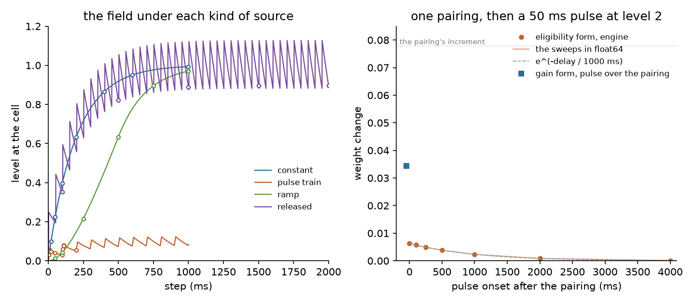

# The modulator, measured on 0.3.0

A modulator node (MODEL.md 4, neuromodulation) raises a level at every cell of a population: a time course the engines hold (constant, pulse train, ramp, or while a presentation is on), or the spikes of a releasing population, each spike adding the node's level times 1000 over the population's cell count. The level decays with the checkpoint's `modTau` (default 200 ms), and the checkpoint's modulation settings say what it does: the Hebbian terms of the pair rule scale with `modBase` plus the level at the postsynaptic cell (the gain form), or accumulate on an eligibility trace per synapse that a sweep every `modStep` ms pays into the weight by `modBase` plus the level (the eligibility form), the synaptic current scales with `1 + modDrive` times the level, and `modCur` times the level is added as a current. This record measures the field and the two learning forms on the 0.3.0 tree as released, with the tools that ship in it. Every command below runs from the repository root; the Brian 2 comparison needs Brian 2 in `.venv-analysis` (EXTENDING.md).

Run on 2026-11-05 on one machine with an sm_89 NVIDIA GPU. Rates are from single runs on one seed unless a tool says otherwise.

## 1. The field against its equation

`node tools/modsteps.mjs` runs three cells on the reference engine: a presynaptic and a postsynaptic cell fired through an input map at chosen steps, and a third cell, fired by a pulse train, that releases onto the postsynaptic cell when a releasing population is measured. The field is read through a pairing: under the gain form with the learning base at 0, one pre-post pairing moves the weight by the level at the postsynaptic cell times the pair rule's increment, so the weight after the pairing gives the level as the step before the post spike left it. The equation is stepped in float64 beside the run: the level decays by `e^(-1/200)` each step, a time course adds its level times `1 - e^(-1/200)` times its scale at the step, and a releasing cell's spike adds `0.05 times 1000` (its level per Hz times 1000 over its one cell) times `1 - e^(-1/200)` the step after it fires.

| source | step | equation | engine | difference |
|---|---|---|---|---|
| constant, level 1 | 10 | 0.053515 | 0.053515 | -6.8e-8 |
| constant, level 1 | 20 | 0.099675 | 0.099675 | -5.0e-8 |
| constant, level 1 | 50 | 0.225084 | 0.225084 | 3.4e-7 |
| constant, level 1 | 100 | 0.396494 | 0.396495 | 8.1e-7 |
| constant, level 1 | 200 | 0.633955 | 0.633956 | 7.7e-7 |
| constant, level 1 | 400 | 0.865340 | 0.865341 | 1.3e-6 |
| constant, level 1 | 600 | 0.950461 | 0.950462 | 7.5e-7 |
| constant, level 1 | 1000 | 0.993296 | 0.993296 | 8.2e-7 |
| pulse train, level 1, 10 of every 100 ms | 5 | 0.029554 | 0.029554 | -1.4e-7 |
| pulse train, level 1, 10 of every 100 ms | 9 | 0.048771 | 0.048770 | -1.3e-7 |
| pulse train, level 1, 10 of every 100 ms | 10 | 0.048527 | 0.048528 | 5.1e-7 |
| pulse train, level 1, 10 of every 100 ms | 20 | 0.046161 | 0.046161 | 1.8e-8 |
| pulse train, level 1, 10 of every 100 ms | 50 | 0.039731 | 0.039731 | 2.1e-7 |
| pulse train, level 1, 10 of every 100 ms | 99 | 0.031097 | 0.031097 | -2.5e-7 |
| pulse train, level 1, 10 of every 100 ms | 105 | 0.059733 | 0.059733 | 2.7e-7 |
| pulse train, level 1, 10 of every 100 ms | 109 | 0.078351 | 0.078352 | 1.3e-7 |
| pulse train, level 1, 10 of every 100 ms | 110 | 0.077961 | 0.077961 | 5.9e-7 |
| pulse train, level 1, 10 of every 100 ms | 200 | 0.054697 | 0.054697 | -1.9e-7 |
| ramp, level 1 over 500 ms | 50 | 0.011741 | 0.011741 | -2.7e-7 |
| ramp, level 1 over 500 ms | 100 | 0.043005 | 0.043005 | -2.5e-7 |
| ramp, level 1 over 500 ms | 250 | 0.215315 | 0.215315 | 2.4e-7 |
| ramp, level 1 over 500 ms | 500 | 0.633751 | 0.633752 | 6.5e-7 |
| ramp, level 1 over 500 ms | 750 | 0.895068 | 0.895068 | 3.6e-7 |
| ramp, level 1 over 500 ms | 1000 | 0.969936 | 0.969937 | 3.4e-7 |
| released, 0.05 per Hz, one cell at 20 Hz | 100 | 0.351678 | 0.351679 | 7.6e-7 |
| released, 0.05 per Hz, one cell at 20 Hz | 500 | 0.822112 | 0.822112 | -1.3e-7 |
| released, 0.05 per Hz, one cell at 20 Hz | 1000 | 0.889699 | 0.889699 | -2.6e-7 |
| released, 0.05 per Hz, one cell at 20 Hz | 1500 | 0.895247 | 0.895247 | -2.2e-7 |
| released, 0.05 per Hz, one cell at 20 Hz | 2000 | 0.895702 | 0.895702 | -2.4e-7 |

The largest difference is 1.3e-6, the engine's float32 stores against the equation in float64. The constant source reaches `1 - e^(-t/200)` of its level, the ramp follows its scale, the pulse train rises over each pulse and decays between. The released field is read just before each spike of the releasing cell, which is why those samples sit below the mean; over steps 1000 to 1049 its mean is 0.9946, against 1.0000 for the level times the cell's rate (20 spikes in the first second, at steps 2, 53, 103, ...). A time course gated to presentations (the node's fourth mode) is the constant course with the curriculum's gate on its amplitude and is not measured here.



## 2. One pairing, then a pulse

The same tool pairs the cells once (the presynaptic cell at 100 ms, the postsynaptic at 105) and follows the pairing with a 50 ms pulse of the modulator at level 2, starting at a delay after the post spike, under the gain form and under the eligibility form (`modStep` 10 ms, `eligTau` 1000 ms), both with the learning base at 0; the run continues 2 s past the pulse so the sweeps pay what the trace has to pay. The pair rule's increment for the pairing is 0.077880. The fourth column is the sweeps stepped in float64: the trace written at the post spike, and at every tenth step after it the trace times `1 - e^(-10/1000)` times the level paid into the weight and the trace decayed by `e^(-10/1000)`.

| pulse onset after the pairing (ms) | gain form | eligibility form | eligibility, the sweeps in float64 | e^(-delay / trace tau) |
|---|---|---|---|---|
| -50 | 0.034454 | 0.005741 | 0.005741 | 1.000 |
| 0 | 0.000000 | 0.006330 | 0.006331 | 1.000 |
| 100 | 0.000000 | 0.005728 | 0.005728 | 0.905 |
| 250 | 0.000000 | 0.004930 | 0.004930 | 0.779 |
| 500 | 0.000000 | 0.003840 | 0.003840 | 0.607 |
| 1000 | 0.000000 | 0.002329 | 0.002329 | 0.368 |
| 2000 | 0.000000 | 0.000857 | 0.000857 | 0.135 |
| 4000 | 0.000000 | 0.000116 | 0.000116 | 0.018 |

The gain form pays only when the pulse covers the pairing: with the pulse from 55 to 104 ms the level at the step before the post spike is `2 (1 - e^(-50/200))`, 0.4424, and the weight moves by 0.4424 times the increment. A pulse that starts at the post spike or later pays nothing in that form. The eligibility form pays a pulse that arrives after the pairing, in proportion to `e^(-delay/eligTau)` (the third and fifth columns agree to three digits from 100 ms on), and the engine's float32 sweeps match the float64 ones to the sixth digit. The amount paid is the level integrated over the trace's life in units of the trace time constant: the 50 ms pulse at level 2 and its decay integrate to about 100 ms times level, a tenth of `eligTau`, so a pulse right after the pairing pays 0.00633, about a tenth of the increment, less the trace's own decay. The pulse that starts 50 ms before the pairing pays less than the one at 0 because the trace does not exist for its first 50 ms.

A level held through the run, the same pairing, 8 s:

| level | gain form | eligibility form | eligibility, the sweeps in float64 |
|---|---|---|---|
| none, learning base 1 | 0.077880 | 0.077852 | 0.077851 |
| 1 held from the start, base 0 | 0.031810 | 0.070175 | 0.070174 |
| 1 held from the start, base 1 | 0.109690 | 0.148025 | 0.148025 |

With no modulator and the base at 1 both forms pay the whole increment, the eligibility form over the trace's life (0.04 percent is still on the trace after 8 s). A level held at 1 from the start is 0.4085 at the pairing and 1 for most of the trace's life: the gain form pays the level at the pairing, the eligibility form the level over the trace, 0.70 of the increment because the level is still rising during the first sweeps. That is what the sweep's factor is for (MODEL.md 4): a level means in the eligibility form what it means in the gain form, once it is held.

## 3. The engines agree

The reference engine against the arithmetic, the CUDA child against the reference on the same cases through the same input map, and the reference against the Brian 2 transcription of its step (the `mod` cases of `tools/brianref.mjs`, which carry the field, the gain and eligibility forms, the synaptic gain under the kick, exponential and conductance synapses, the current, and a releasing population; every spike train and every weight identical):

```
=== node src/mod.test.mjs
mod: all passed (13)

=== node cuda/modtest.mjs
cuda modtest: all passed (15)

=== node tools/brianref.mjs mod
brianref: the reference engine against brian2 2.10.1
  channels        400 cells    6486 spikes    8.1 Hz   identical 400/400   brian 18.0 s
  channels cond   400 cells    4343 spikes    5.4 Hz   identical 400/400   brian 18.2 s
  static short    200 cells    3694 spikes    9.2 Hz   identical 200/200   brian 4.2 s
  stdp soft       200 cells    3668 spikes    9.2 Hz   identical 200/200   weights 3975/3975 (2339 moved)   same-ms pairs 377/414   brian 10.0 s
  mod drive       200 cells    3693 spikes    9.2 Hz   identical 200/200   brian 3.4 s
  mod drive exp   400 cells    6115 spikes    7.6 Hz   identical 400/400   brian 13.8 s
  mod drive cond  400 cells    4250 spikes    5.3 Hz   identical 400/400   brian 14.2 s
  mod current     200 cells    4925 spikes   12.3 Hz   identical 200/200   brian 3.5 s
  mod gain        200 cells    3661 spikes    9.2 Hz   identical 200/200   weights 3975/3975 (2339 moved)   brian 10.1 s
  mod elig        200 cells    3668 spikes    9.2 Hz   identical 200/200   weights 3975/3975 (2339 moved)   brian 10.7 s
  mod release     200 cells    3672 spikes    9.2 Hz   identical 200/200   weights 3975/3975 (2352 moved)   brian 10.2 s
brianref: all passed (50)
```

The WebGPU engine is compared in the battery's neuromodulation group (`validate.html?only=neuromodulation`, Chrome on the same machine): one pairing under each form on both page engines, a releasing cell, and the synaptic gain and the current on a 1,500-cell balanced net under noise. Output:

```
## neuromodulation | PASS | 30.8 s
- the gain form with base 0 and no modulator learns nothing: plain 0.0055, base 0 0.00000 (no change at base 0) ok
- a constant level scales the pairing by the level at the post spike: 0.0033 against 0.0033 expected (level 0.591) (the plain change times the level, within 3%) ok
- the eligibility form moves nothing until a modulator arrives: 0.00000 with no modulator, 0.00031 with a pulse 80 ms after the pairing (0 without, above 0 and below the plain change with) ok
- a releasing population raises the level at its target: 0.0132 against 0.0132 expected (level 2.396) (the plain change times the level the release leaves, within 3%) ok
- a synaptic gain per level raises the rate: 25.20 Hz unmodulated, 39.23 at a gain of 1.5 (above the unmodulated rate by more than 10%) ok
- a current per level raises the rate: 25.20 Hz unmodulated, 44.14 with 4 pA per unit level (above the unmodulated rate by more than 10%) ok
- gpu: the gain form agrees with the reference: gain gpu 0.0033 cpu 0.0033; release gpu 0.0132 cpu 0.0132; base 0 gpu 0.00000 (within 10% on the pairing and the release, 0 at base 0) ok
- gpu: the eligibility form agrees with the reference: gpu 0.00031 cpu 0.00031; without a modulator gpu 0.00000 (within 10%, 0 without) ok
- gpu: the synaptic gain and the current move the rate as on the reference: gain gpu 39.23 cpu 39.23 Hz; current gpu 44.64 cpu 44.14 Hz (within 25%) ok
```

## 4. What it does on the every node scene

The every node scene is the Tab-menu scene that carries a modulator: its core's interneurons (`inh`) release onto its pyramids (`exc`) at 0.02 per Hz of their mean rate, and the checkpoint reads the level as a gain on the pair rule (learning `gain`, base 1), so the rule learns faster while the interneurons are busy. `node tools/tune.mjs "every node" 3 1` computes the scene at full resolution (43,060 cells, 11.2 M synapses) and runs it 3 s on the reference engine. The interneurons fire at 8.07 Hz, so the level at the pyramids settles near 0.16. The two settings that read the level into the cell's current were given on the checkpoint to show what they do on this scene; they are off as shipped.

| setting | exc (Hz) | inh (Hz) | tier 1 arm | tier 2 arm | tier 3 arm |
|---|---|---|---|---|---|
| as shipped (learning gain, base 1) | 1.19 | 8.07 | 5.00 | 8.85 | 35.47 |
| modulator level 0 | 1.18 | 8.07 | 5.00 | 8.84 | 35.48 |
| synaptic gain per level 1 | 1.43 | 8.38 | 5.00 | 8.90 | 35.50 |
| synaptic gain per level -0.5 | 1.10 | 7.97 | 5.00 | 8.82 | 35.48 |
| current per level 20 pA | 1.50 | 8.41 | 5.00 | 8.86 | 35.49 |
| current per level -20 pA | 0.96 | 7.83 | 5.00 | 8.82 | 35.51 |

As shipped the modulator changes the rule's gain and nothing else, so the rates with its level at 0 are the rates with it on. A synaptic gain of 1 per level multiplies the pyramids' synaptic current by about 1.16 and moves them from 1.19 to 1.43 Hz; a current of 20 pA per level adds about 3 pA and moves them to 1.50. The interneurons follow the pyramids through the core's recurrence. The arms of the tiers, which the pyramids project to, move by at most 0.05 Hz. The tissue-scenes group of the battery holds the scene's two core populations to their bands with the modulator on.

The commands:

```
node tools/tune.mjs "every node" 3 1
OVER="modulator:*:level=0" node tools/tune.mjs "every node" 3 1
OVER="checkpoint:*:modDrive=1" node tools/tune.mjs "every node" 3 1
OVER="checkpoint:*:modDrive=-0.5" node tools/tune.mjs "every node" 3 1
OVER="checkpoint:*:modCur=20" node tools/tune.mjs "every node" 3 1
OVER="checkpoint:*:modCur=-20" node tools/tune.mjs "every node" 3 1
```

## 5. Cost

`node tools/enginebench.mjs <scene> --over "checkpoint:*:plast=1;checkpoint:*:modPlast=N" --engines cpu,cuda,webgpu --serve URL --project DIR` computes a scene once and times the same network on the reference engine (1 simulated second after a 1 s warm-up), the CUDA engine and the WebGPU engine (5 s each). Speed is simulated time over wall time; each engine's mean rate is printed beside it. The bench drives a scene through its stimulus nodes and does not run the every node scene (input maps), so the network here is the balanced random net (24,127 cells, 14.4 M synapses) and `validation/modulated-net.json`, the same scene with a modulator holding a level of 1 at every cell; nothing on the checkpoint reads the level unless a setting below says so, so the first pair of rows is the cost of the field itself.

Plasticity off, as shipped. The reference engine timed over 5 s (`--cpu-seconds 5`), since over 1 s its reading varied between runs by more than the field costs:

| network | cpu, 5 s | cuda | webgpu | mean rate (Hz) |
|---|---|---|---|---|
| balanced random net | 1.85x, 118 M/s | 25.28x, 1614 M/s | 2.53x, 161 M/s | 4.89 |
| with the field | 1.69x, 108 M/s | 21.07x, 1345 M/s | 2.42x, 154 M/s | 4.89 |

Plasticity on (the pair rule as the checkpoint has it), the learning setting on the modulated net at each of its three choices:

| network | learning | cpu | cuda | webgpu | mean rate under each (Hz) |
|---|---|---|---|---|---|
| balanced random net | (no modulator) | 0.04x, 12 M/s | 5.58x, 1574 M/s | 0.41x, 116 M/s | 19.02, 19.29, 19.30 |
| with the field | unmodulated | 0.04x, 12 M/s | 5.45x, 1535 M/s | 0.43x, 120 M/s | 19.02, 19.28, 19.30 |
| with the field | gain | 0.04x, 12 M/s | 5.72x, 1647 M/s | 0.43x, 124 M/s | 19.15, 19.67, 19.67 |
| with the field | eligibility | 0.03x, 8 M/s | 2.95x, 840 M/s | 0.34x, 98 M/s | 19.14, 19.48, 19.45 |

The field costs the reference engine 9 percent, the CUDA engine 17 percent and the WebGPU engine 4 percent with plasticity off, and nothing measurable with plasticity on, where the learning passes dominate. The gain form costs nothing beyond the field. The eligibility form is the sweep over every excitatory plastic synapse every 10 ms and its trace's four bytes per synapse: it costs the CUDA engine half its speed on this network, the WebGPU engine 21 percent and the reference engine 44 percent (34.4 s against 23.9 s for the simulated second). Under the pair rule the net runs up from 4.89 to about 19 Hz on every engine; under the gain form with the base at 1 and the level at 1 the rule's terms are doubled and the rate reads 19.67 Hz, under the eligibility form 19.45. The three engines report the same mean rate under each setting.

The outputs:

```
=== balanced random net | as shipped
balanced random net: 24,127 cells, 14,402,930 synapses (mean in-degree 597), plasticity off, computed in 9.8 s
webgpu      2.53x realtime      161 M deliveries/s    4.89 Hz mean  (5 s simulated in 1.98 s; init and warm-up 1.5 s)
cuda       25.28x realtime     1614 M deliveries/s    4.89 Hz mean  (5 s simulated in 0.20 s; init and warm-up 0.6 s)
cpu         1.04x realtime       66 M deliveries/s    4.87 Hz mean  (1 s simulated in 0.96 s; init and warm-up 1.1 s)
=== validation/modulated-net.json | as shipped (the field on, plasticity off)
modulated-net: 24,127 cells, 14,402,930 synapses (mean in-degree 597), plasticity off, computed in 9.7 s
webgpu      2.42x realtime      154 M deliveries/s    4.89 Hz mean  (5 s simulated in 2.06 s; init and warm-up 1.5 s)
cuda       21.07x realtime     1345 M deliveries/s    4.89 Hz mean  (5 s simulated in 0.24 s; init and warm-up 0.6 s)
cpu         1.40x realtime       89 M deliveries/s    4.87 Hz mean  (1 s simulated in 0.71 s; init and warm-up 0.8 s)
=== balanced random net | --engines cpu --cpu-seconds 5
cpu         1.85x realtime      118 M deliveries/s    4.89 Hz mean  (5 s simulated in 2.70 s; init and warm-up 0.6 s)
=== validation/modulated-net.json | --engines cpu --cpu-seconds 5
cpu         1.69x realtime      108 M deliveries/s    4.89 Hz mean  (5 s simulated in 2.95 s; init and warm-up 0.6 s)
=== balanced random net | checkpoint:*:plast=1
balanced random net: 24,127 cells, 14,402,930 synapses (mean in-degree 597), plasticity on, computed in 10.1 s
webgpu      0.41x realtime      116 M deliveries/s   19.30 Hz mean  (5 s simulated in 12.19 s; init and warm-up 4.0 s)
cuda        5.58x realtime     1574 M deliveries/s   19.29 Hz mean  (5 s simulated in 0.90 s; init and warm-up 0.7 s)
cpu         0.04x realtime       12 M deliveries/s   19.02 Hz mean  (1 s simulated in 23.98 s; init and warm-up 28.3 s)
=== validation/modulated-net.json | checkpoint:*:plast=1;checkpoint:*:modPlast=0
modulated-net: 24,127 cells, 14,402,930 synapses (mean in-degree 597), plasticity on, computed in 8.9 s
webgpu      0.43x realtime      120 M deliveries/s   19.30 Hz mean  (5 s simulated in 11.75 s; init and warm-up 3.8 s)
cuda        5.45x realtime     1535 M deliveries/s   19.28 Hz mean  (5 s simulated in 0.92 s; init and warm-up 0.7 s)
cpu         0.04x realtime       12 M deliveries/s   19.02 Hz mean  (1 s simulated in 23.91 s; init and warm-up 24.4 s)
=== validation/modulated-net.json | checkpoint:*:plast=1;checkpoint:*:modPlast=1
modulated-net: 24,127 cells, 14,402,930 synapses (mean in-degree 597), plasticity on, computed in 8.8 s
webgpu      0.43x realtime      124 M deliveries/s   19.67 Hz mean  (5 s simulated in 11.61 s; init and warm-up 3.8 s)
cuda        5.72x realtime     1647 M deliveries/s   19.67 Hz mean  (5 s simulated in 0.87 s; init and warm-up 0.6 s)
cpu         0.04x realtime       12 M deliveries/s   19.15 Hz mean  (1 s simulated in 23.96 s; init and warm-up 24.2 s)
=== validation/modulated-net.json | checkpoint:*:plast=1;checkpoint:*:modPlast=2
modulated-net: 24,127 cells, 14,402,930 synapses (mean in-degree 597), plasticity on, computed in 8.8 s
webgpu      0.34x realtime       98 M deliveries/s   19.45 Hz mean  (5 s simulated in 14.53 s; init and warm-up 4.3 s)
cuda        2.95x realtime      840 M deliveries/s   19.48 Hz mean  (5 s simulated in 1.70 s; init and warm-up 0.8 s)
cpu         0.03x realtime        8 M deliveries/s   19.14 Hz mean  (1 s simulated in 34.43 s; init and warm-up 34.4 s)
```
